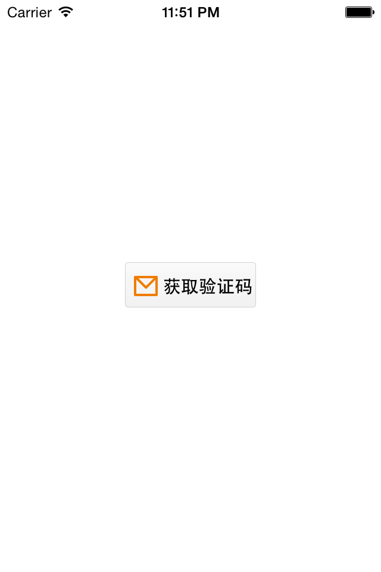
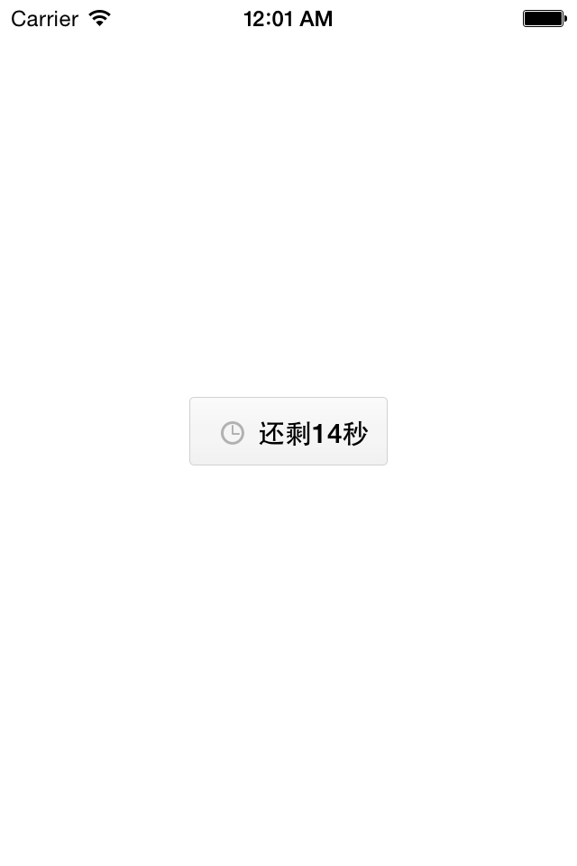

# SMSCodeButton

| 中文 | English |
|:---|:---|
| 可用作短信验证码的倒计时 Button：点击「获取验证码」后显示「还剩N秒」，期间按钮不可用，结束后显示「重新获取」。纯 Swift 示例。 | A countdown button for SMS verification codes: a tap on "Get code" shows "N s left", the button is disabled meanwhile, and "Resend" shows at the end. A pure Swift demo. |
| 按钮是 [CYLTabBarController](https://github.com/ChenYilong/CYLTabBarController) 中 `CYLAnimatedItem` pod 的 `CYLAnimatedItemView` 的倒计时样式，全部倒计时逻辑都在该组件中。 | The button is the countdown style of `CYLAnimatedItemView` in the `CYLAnimatedItem` pod of [CYLTabBarController](https://github.com/ChenYilong/CYLTabBarController); all the countdown logic is in that component. |

## [CN]用法
## [EN]Usage

```ruby
# Podfile: the latest commit of CYLTabBarController (scripts/latest-cyl-commit.sh --podfile)
pod 'CYLAnimatedItem', :git => 'https://github.com/ChenYilong/CYLTabBarController.git', :commit => 'c6b4afded3a6a8a73a8ce718d5cdd1d7223bc7ec'
```

```swift
import CYLAnimatedItem

let sendButton = CYLAnimatedItemView(frame: .zero)
sendButton.style = .countdown
sendButton.image = UIImage(named: "timerBtn_imageView_normal")            // idle / finished
sendButton.countdownImage = UIImage(named: "timerBtn_imageView_selected") // running
sendButton.countdownIdleTitle = "Get code"
sendButton.countdownRunningTitleFormat = "%ld s left"
sendButton.countdownFinishedTitle = "Resend"
sendButton.countdownDuration = 60
sendButton.startsCountdownOnTap = true   // or call startCountdown() after the server accepted the request
sendButton.delegate = self               // animatedItemViewDidTap(_:): send the code
```

| 中文 | English |
|:---|:---|
| 完整示例：[CYLSNSCodeButtonViewController.swift](SNSCodeTimerDemo/CYLSNSCodeButtonViewController.swift)。文档：[docs/Countdown-Button.md](docs/Countdown-Button.md)。 | Full example: [CYLSNSCodeButtonViewController.swift](SNSCodeTimerDemo/CYLSNSCodeButtonViewController.swift). Guide: [docs/Countdown-Button.md](docs/Countdown-Button.md). |
| 进入后台、锁屏的时间也计入（结束时间保存为日期，回到前台立即重新读取）；每秒只改变同一个标题，不闪烁；宽度保持最宽标题的宽度，不抖动（[issue #1](https://github.com/ChenYilong/SMSCodeButton/issues/1)）。 | The time in the background or with the screen locked counts (the end is kept as a date and read again when the app returns); only the same title changes each second, so nothing flickers; the width stays that of the widest title, so it does not jump ([issue #1](https://github.com/ChenYilong/SMSCodeButton/issues/1)). |
| 支持 VoiceOver（读出剩余秒数，倒计时中为不可用状态，结束时播报）、动态字体、深色模式、`en` 与 `zh-Hans`。 | VoiceOver (reads the seconds left, "dimmed" while counting, announces the end), Dynamic Type, Dark Mode, `en` and `zh-Hans`. |

## [CN]效果
## [EN]Look

| 中文 | English |
|:---|:---|
| 下面两张是旧版（Objective-C）的截图：待机与倒计时中（iOS 7 模拟器，2014-11-23 与 2014-11-24）。新版在 Swift 与组件上重写，外观一致，新截图待在 Mac 上补拍（见 [docs/Countdown-Button.md](docs/Countdown-Button.md)）。 | The two below are of the old (Objective-C) version: idle and counting (iOS 7 simulator, 2014-11-23 and 2014-11-24). The new version is rewritten in Swift on the component with the same look; new screenshots are still to be taken on a Mac (see [docs/Countdown-Button.md](docs/Countdown-Button.md)). |





Check out [my weibo](http://weibo.com/luohanchenyilong/) for more info.

Check out [my twitter](https://twitter.com/stevechen1010) for more info.
